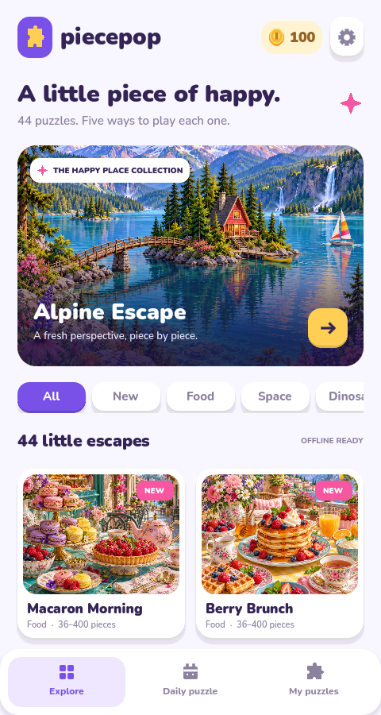
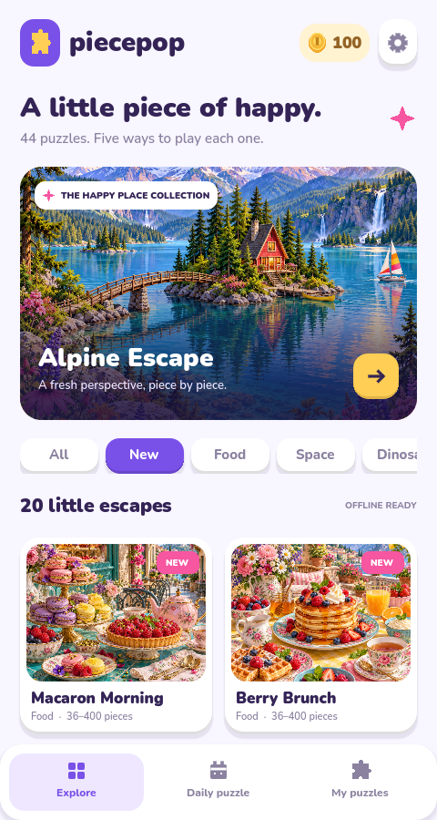
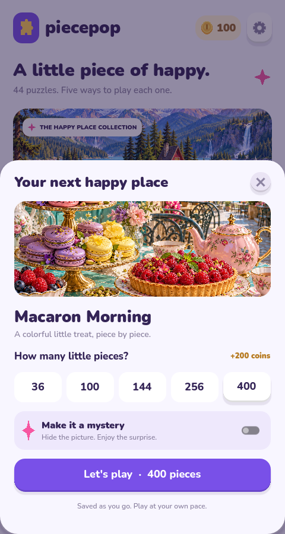
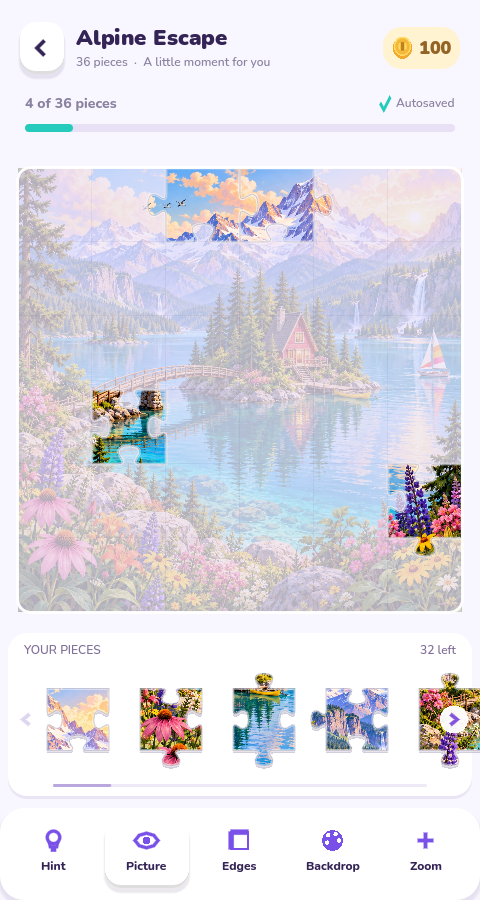
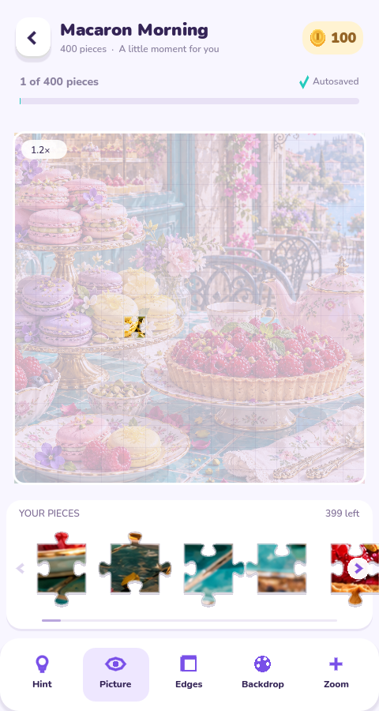
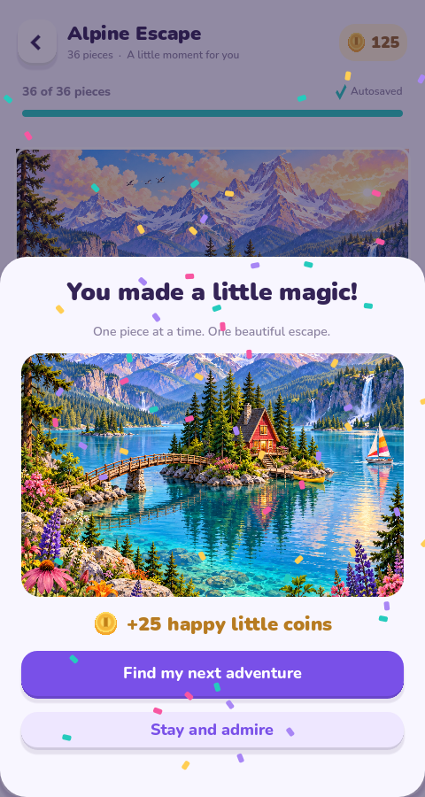

# Piecepop

A cheerful, portrait-first jigsaw game built with **Godot 4.6.3** and GDScript. Pink, aqua, purple, warm yellow, original scenery, and soft dimensional controls keep the gallery playful while the puzzle board stays quiet and readable.

## Screenshots

Actual screenshots of version 0.3.0 running in Chromium at a 480 × 900 portrait viewport. Select an image to view the full-size PNG.

| Puzzle gallery | 20 new puzzles | Choose your difficulty |
| --- | --- | --- |
| [](docs/screenshots/gallery.png) | [](docs/screenshots/new-puzzles.png) | [](docs/screenshots/difficulty.png) |

| 36-piece gameplay | 400-piece gameplay and zoom | Completion and rewards |
| --- | --- | --- |
| [](docs/screenshots/gameplay.png) | [](docs/screenshots/gameplay-400.png) | [](docs/screenshots/completed.png) |

## Run the game

1. Install the standard edition of [Godot 4.6.3](https://github.com/godotengine/godot-builds/releases/tag/4.6.3-stable).
2. Import `project.godot` in the Godot project manager.
3. Press **F6** to run the main scene, or **F5** to run the project.

From a terminal in this directory:

```sh
godot --editor --path .
godot --path .
```

The base layout is 480 × 900 and expands to fit other portrait screens. The Compatibility renderer supports desktop, mobile, and Web. All puzzle artwork ships with the game and is available offline; the app has no ad SDK, account, or backend dependency.

In this managed cloud workspace, set writable Godot directories before running any Godot command:

```sh
export XDG_DATA_HOME=/workspace/.godot-tools/share
export XDG_CONFIG_HOME=/workspace/.godot-tools/editor-config
export XDG_CACHE_HOME=/workspace/.cache
```

The existing checkout is `/workspace/Jigsaw-Puzzle`. Godot 4.6.3 and the matching export templates are installed, and the local preview runs on port 8060.

## Play

Browse a category, open a puzzle, and choose **36, 100, 144, 256, or 400 pieces**. Drag pieces from the bottom tray to the board; correct neighbors join into movable groups and correctly placed pieces snap home. Touch and mouse use the same controls. Use the hints, reference image, edge filter, zoom controls, and background switcher while solving. Mystery mode hides the reference. Progress and earned coins are stored locally in Godot's `user://` directory. Web saves depend on browser site storage and are removed if the site's data is cleared.

The library contains **44 original puzzles** in **11 categories**: Nature, Animals, Art, Places, Fantasy, Food, Space, Dinosaurs, Festivals, Cozy Rooms, and Architecture. **28 puzzles are free** and **16 unlock with earned coins**. Every puzzle supports 36, 100, 144, 256, and 400 pieces (220 image/difficulty combinations), with classic and mystery play.

Version **0.3.0** adds **20 individually generated, 1254 × 1254 PNG illustrations**. The **New** filter highlights only this collection, and its six new categories appear first in the gallery filters. Earlier collections remain available in All and their original categories.

| Category | New puzzles |
| --- | --- |
| Food | Macaron Morning, Berry Brunch, Sushi Symphony, Gelato Parade |
| Space | Saturn Picnic, Lunar Greenhouse, Nebula Observatory, Comet Express |
| Dinosaurs | Dino Watering Hole, Triceratops Trail, Pterosaur Lagoon |
| Festivals | Lantern River, Carnival of Colors, Winter Market |
| Cozy Rooms | Storybook Library, Artist Sunroom, Baker Workshop |
| Architecture | Mosaic Courtyard, Clockwork Square, Floating Palazzo |

The daily puzzle rotates through all 28 free images by local date, once per 28-day cycle. Every illustration is bundled for offline play. Existing puzzle IDs, coin balances, purchases, and unfinished games remain compatible with earlier saves.

The gallery caches 512-pixel previews and a small number of recent full-resolution images. Puzzle boards always use the original artwork, so zooming and 400-piece play retain full detail without keeping the entire collection in GPU memory.

## Validate

```sh
godot --headless --editor --path . --import --quit
godot --headless --path . --script tests/state_test.gd
godot --headless --path . --script tests/board_test.gd
godot --headless --path . --script tests/app_test.gd
godot --headless --path . --script tests/catalog_test.gd
```

The headless suites cover state/economy, puzzle geometry/input, and the integrated app. After exporting Web and starting the preview server, run `python3 tests/web_smoke.py` for a real Chromium regression covering drag, hints, browser autosave, reload/resume, completion, and rewards. It requires Python Playwright and Chromium, uses an isolated browser save, and writes screenshots to `builds/screenshots/`.

## Web preview

Install the export templates that match **4.6.3** using Godot's **Editor → Manage Export Templates**. The `Web` preset disables threads for wider browser support.

For a noninteractive installation, `python3 tools/install_templates.py` installs the official Web, Android, and Linux templates after verifying the upstream SHA-512 checksum. It downloads about 1.2 GB once, removes the archive afterward, and reuses existing templates on subsequent runs.

```sh
mkdir -p builds/web
touch builds/.gdignore
godot --headless --path . --export-release Web builds/web/index.html
python3 tools/serve_web.py
```

Serve the build locally with the command above. The onboarding UI does not expose a public preview URL. The Python standard-library server includes the correct WebAssembly MIME type and cross-origin isolation headers. Stop it with Ctrl+C. For a device on your trusted local network, use `--bind 0.0.0.0`; deployed Web builds should use HTTPS. Exported files are generated under `builds/` and excluded from Git.

## Android

The included `Android` preset targets ARM64 phones in portrait orientation. Install **OpenJDK 17**, the Android SDK, and Godot's matching export templates. In **Editor Settings → Export → Android**, set **Java SDK Path** and **Android SDK Path**. Follow [Godot's Android export documentation](https://docs.godotengine.org/en/4.6/tutorials/export/exporting_for_android.html) for the required SDK components and debug signing setup.

For Linux x86_64, the standard-library helper `python3 tools/install_android_sdk.py --sdk-root /path/to/android-sdk --configure-godot` installs Google's checksum-verified platform tools and Build-Tools 36.0.0, then sets the SDK and Java paths in Godot's editor settings. This small SDK subset is sufficient for the supplied non-Gradle APK preset. Gradle/AAB builds need the full Android SDK setup from the official guide.

```sh
mkdir -p builds/android
touch builds/.gdignore
godot --headless --path . --export-debug Android builds/android/piecepop.apk
adb install -r builds/android/piecepop.apk
```

In this workspace, the SDK is installed at `/workspace/.godot-tools/android-sdk` and Android export settings are in a separate configuration directory. Build with:

```sh
XDG_CONFIG_HOME=/workspace/.godot-tools/config godot --headless --path . --export-debug Android builds/android/piecepop.apk
```

The debug APK has been built and its v2/v3 signatures verified. It targets Android 16 (SDK 36) and supports Android 7 (SDK 24) or later on ARM64. Native device/emulator execution has not been tested here. Before publishing, set your own application ID, release keystore, store metadata, and version. Test touch accuracy, safe areas, lifecycle resume, and performance on real target phones. iOS requires macOS/Xcode and Apple signing and is not built in this Linux workspace.

## Assets and source

The game uses original puzzle art and locally bundled Nunito type under the SIL Open Font License; its license is in `assets/fonts/OFL.txt`. Godot's project, GDScript source, and bundled assets are editable directly. Cloud tasks already run in an isolated checkout; use this checkout without creating another Git worktree.
